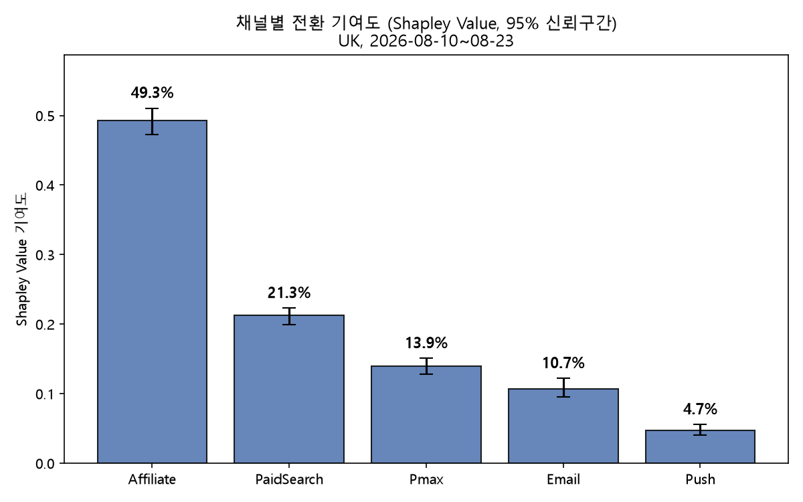
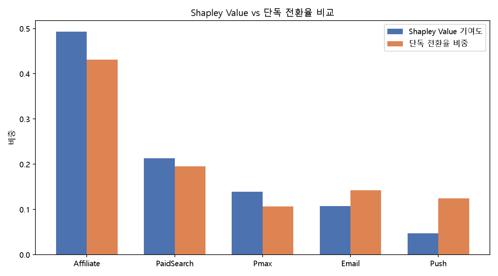

# 캠페인 채널 기여도 및 인과 효과 분석

Samsung.com UK 캠페인 데이터(Adobe Analytics, 2026-08-10~08-23, 방문자 약 16,800명)로
"어떤 채널이 전환에 얼마나 기여했는가"를 두 가지 다른 방법론으로 분석하고,
그 과정에서 방법론 자체의 한계를 실데이터로 검증한 프로젝트입니다.

기존에 하던 인과추론/어트리뷰션 작업이 전부 합성(synthetic) 데이터 기반이었다는 걸 깨닫고,
실제 데이터로 처음부터 다시 해보면서 겪은 문제와 해결 과정을 정리했습니다.

---

## 1. 채널 기여도 산출 — Shapley Value

5개 채널(Email, Push, Pmax, Affiliate, PaidSearch)의 노출 조합별 전환 데이터를 바탕으로,
Shapley Value로 각 채널의 기여도를 계산했습니다.

- 가치함수 v(S)는 "S에 포함된 채널들의 부분집합이 터치한 사람들의 전환 수"로 정의
- Shapley의 효율성 공리(각 채널 기여도의 합 = 전체 전환 수)로 계산이 맞는지 검증
- 채널 간 기여도 차이가 통계적으로 유의한지 Bootstrap / Paired Bootstrap으로 확인

  

Affiliate가 49.3%로 압도적인 기여도를 보였고, Push는 4.7%로 가장 낮았습니다. 오차막대(95% CI)를
보면 채널 간 차이가 우연이 아니라는 것도 확인됩니다.

단순 전환율 비중(그 채널을 단독으로 접촉한 사람들만의 전환율)과 비교해보면, Shapley Value가
왜 필요한지가 드러납니다.

  

Push는 단독 전환율 비중(약 12%대)보다 Shapley 기여도(4.7%)가 훨씬 낮게 나옵니다 — Push가
다른 채널과 함께 노출됐을 때는 그 조합의 전환을 다른 채널의 몫으로 더 많이 돌렸다는 뜻입니다.
반대로 Pmax는 단독 비중보다 Shapley 기여도(13.9%)가 더 높게 나옵니다.

여기까지는 잘 나왔습니다. 그런데 이 숫자를 그대로 "이 채널이 이만큼 효과가 있다"고 해석해도 되는지
의문이 남았습니다.

## 2. 근데 이게 맞나 — Shapley의 한계

Shapley Value는 **관측된 전환을 채널들 사이에 어떻게 나눌지 정하는 방법(allocation)**이지,
**그 채널이 없었다면 전환이 안 됐을지를 따지는 방법(causal identification)**이 아닙니다.

예를 들어 특정 채널이 원래 구매 가능성이 높은 사람 위주로 노출된다면, 그 채널의 기여도가
높게 나오는 게 채널 자체의 효과 때문인지, 원래 잘 사는 사람들한테 갔기 때문인지 Shapley
값만으로는 구분이 안 됩니다. 이 한계를 인지하고, 노출 여부를 결정하는 confounder(사전 행동
특성)를 보정하는 절차를 추가하기로 했습니다.

## 3. 선택편향 보정 — IPW (Inverse Probability Weighting)

### 3-1. 무노출 대조군 구축

채널별 효과를 보려면 "그 채널에 노출 안 된 사람"이 필요합니다. 방문자(Visitor) 단위로
세그먼트를 구성해, 캠페인 기간 동안 5개 채널 중 어디에도 노출되지 않은 사람만 대조군으로
추출했고, 노출군과의 중복률은 0.02%였습니다.

### 3-2. Propensity Score + IPW

- 공변량: 모바일 여부, 캠페인 이전 방문 빈도, 과거 구매 이력 (전부 캠페인 시작 전 시점 데이터)
- 채널별로 로지스틱 회귀로 노출 확률(propensity score)을 추정하고, 역수를 가중치로 사용
- 가중치 부여 전후로 공변량이 실제로 균형을 이뤘는지 SMD로 확인
- 가중치 상한(clip) 값을 바꿔가며 결과가 안정적인지 확인

### 3-3. 결과

전체 5개 채널 모두 채널마다 balance(SMD < 0.1)가 맞는 clip 값을 따로 찾아 확정한 값입니다
(Affiliate·Email·Pmax·PaidSearch는 clip=10, Push는 clip=50). 95% CI는 Bootstrap 100회 기준입니다.

| 채널 | 단순 비교 | IPW 보정 ATE | 95% CI |
|---|---|---|---|
| Affiliate | +14.8%p | +12.7%p | [+11.4%p, +13.8%p] |
| PaidSearch | +8.7%p | +6.4%p | [+5.6%p, +7.5%p] |
| Email | +3.4%p | +1.4%p | [+0.5%p, +2.3%p] |
| Pmax | +3.9%p | +1.3%p | [+0.4%p, +2.2%p] |
| **Push** | +0.9%p | **−1.8%p** | **[−3.0%p, −0.5%p]** |

5개 채널 모두 95% CI가 0을 포함하지 않아 통계적으로 유의미했습니다. Push만 부호가 뒤집혔습니다.

## 4. Push는 왜 뒤집혔나 — 디버깅 과정

여기서부터가 이 프로젝트에서 가장 시간을 많이 쓴 부분입니다. 순서대로 가설을 세우고 하나씩
배제해나갔습니다.

**가설 1 — 가중치가 소수에게 쏠려서 평균을 왜곡한다.** IPW 가중치 상한(clip=10)에 걸린
사람이 전체 Push 노출자의 2.7%였고, 이들이 가중치 합에서 차지하는 비중도 4%에 불과했습니다.
이 정도로는 전체 평균을 크게 흔들 수 없어서, **이것도 원인이 아니었습니다.**

**가설 2 — 두 그룹의 공변량 분포 자체가 다르다.** Push 노출자의 평균 propensity score
(0.267)가 대조군(0.159)보다 뚜렷하게 높았습니다. 즉 Push는 애초에 "받을 법한" 사람—방문
빈도와 과거 구매 이력이 높은 사람—위주로 나갔고, 이게 raw 비교에서 Push의 전환율을
실제보다 높아 보이게 만들고 있었을 가능성이 있습니다. IPW로 이 차이를 보정하자, Push의
추정 효과는 음수로 바뀌었습니다.

이 결과가 clip 설정에 따라 흔들리는 우연은 아닌지 확인했습니다.
- 가중치 부여 후 공변량 균형(SMD): 방문 빈도·과거구매이력은 0.1 밑으로 잘 균형 잡혔고,
  모바일 여부는 clip=50 부근에서 균형이 맞춰짐
- clip 값을 10 → 20 → 50 → 무제한으로 바꿔봐도 ATE는 −1.56%p ~ −1.88%p 사이로,
  **부호가 한 번도 안 바뀜**

## 5. 공변량을 늘려도 결론이 유지되는가 — 확장 검증

앞서 한계로 짚었던 부분("공변량 3개로 구매 의도를 충분히 대신할 수 있는가")을 실제로 테스트해봤습니다.

- 기존 3개(모바일 여부·방문빈도·과거구매이력)보다 구매 의도를 더 직접적으로 나타낼 만한 신호를 먼저 후보로 추려봤습니다: 장바구니 담기, 체크아웃 시작, 특정 제품 조회, 사이트 내 검색, 위시리스트, 로그인 여부, 최근성. 이 중 AA로 실제 추출 가능하고 구현이 확인된 3개 — **장바구니 담기, 체크아웃 시작, 로그인 여부** — 를 캠페인 이전 기간 기준으로 추가 추출했습니다.
- 새 변수들이 기존 변수와 얼마나 겹치는지 VIF(분산팽창계수)로 확인 — 전부 5 미만으로, 다중공선성 없이 6개를 모두 함께 사용 가능한 것으로 확인됐습니다.
- 6개 공변량으로 채널별 propensity 모델을 다시 적합하고, clip 값도 다시 탐색했습니다. 패턴은 기존과 동일했습니다 — Push는 clip=50에서만 균형(SMD)이 맞고, Affiliate는 반대로 clip=10(가장 타이트한 값)에서 균형이 가장 좋았습니다.

| 채널 | 3개 공변량 ATE | 6개 공변량 ATE | 95% CI (6개 기준) |
|---|---|---|---|
| Affiliate | +12.7%p | +12.8%p | [+11.7%p, +14.0%p] |
| PaidSearch | +6.4%p | +6.5%p | [+5.4%p, +7.6%p] |
| Email | +1.4%p | +1.9%p | [+0.9%p, +2.9%p] |
| Pmax | +1.3%p | +1.7%p | [+0.7%p, +2.9%p] |
| **Push** | −1.8%p | **−1.6%p** | **[−2.6%p, −0.2%p]** |

5개 채널 모두 여전히 95% CI가 0을 포함하지 않았고, **Push의 부호도 그대로 유지됐습니다.** 장바구니 담기·체크아웃 시작·로그인 여부라는, 기존보다 훨씬 더 직접적인 구매 의도 신호를 추가로 보정했는데도 Push의 음수 효과가 사라지거나 뒤집히지 않았다는 건, 이 결과가 "공변량이 부족해서 생긴 착시"만은 아닐 가능성을 높여주는 근거입니다.

다만 이것도 "관측 가능하고 AA로 뽑을 수 있었던 6개 공변량 안에서"의 얘기입니다. 실시간 재고/가격 변동, 오프라인 접점, 개인화 추천 노출 여부처럼 이번에도 관측하지 못한 신호가 여전히 남아있을 수 있고, 이 데이터만으로는 그 가능성을 완전히 배제할 방법이 없습니다.

## 6. 결론 — 그리고 이 결론이 말할 수 있는 것과 없는 것

- Shapley Value로 계산한 채널별 기여도는 "관측된 전환을 어떻게 나눌지"에는 유효하지만,
  채널 간 노출 대상 차이(선택편향)까지 반영하지는 못한다.
- IPW로 이 편향을 보정하면 Affiliate·PaidSearch는 여전히 뚜렷한 양의 효과를 보이지만,
  Push는 raw 비교에서 양(+)으로 보였던 것과 달리 음(−)으로 나온다. 이 결과는 clip 설정을
  바꿔도 방향이 유지될 만큼 안정적이다.

다만 **"Push는 효과가 없었다, 원래 살 사람한테 갔을 뿐이다"라고 단정하지는 않으려 한다.**
이 결론은 지금 가진 공변량 3개(모바일 여부·방문 빈도·과거 구매 이력)가 "구매 의도"를
얼마나 잘 대신하고 있느냐에 전적으로 기대고 있다. 이 3개 변수로 다 못 잡는 다른 특성
(예: 최근 위시리스트 추가, 장바구니 이탈 등 더 직접적인 구매 신호)이 Push 타겟팅에
쓰였다면, 지금의 음수는 "진짜 Push 효과"가 아니라 "덜 보정된 잔여 선택편향"일 수 있다.
즉 지금 말할 수 있는 것은 **"이 세 공변량 기준으로 보면 Push의 raw 전환율 우위는 사라지고
오히려 역전된다"**는 사실이고, "그래서 Push가 실제로 무의미하거나 해롭다"는 건 그 위에
얹은 해석 중 하나일 뿐 확정된 결론은 아니다.

## 한계

- 공변량을 3개에서 6개로 늘려 더 직접적인 구매 의도 신호(장바구니 담기·체크아웃 시작·
  로그인 여부)까지 보정해봤지만, Push의 음수 효과는 그대로 유지됐다. 이는 결론의
  robustness를 높여주지만, 모든 confounding을 배제했다는 뜻은 아니다 — AA로 뽑을 수 있는
  범위 밖의 신호(실시간 재고/가격 변동, 오프라인 접점, 개인화 추천 노출 등)는 여전히
  관측되지 않은 채 남아있고, 이 데이터만으로는 그 가능성을 완전히 검증할 방법이 없다.
- A/B 테스트로 확인하는 게 이상적이지만 실무 여건상 이번 분석의 범위 밖이라고 보고, 그
  한계를 그대로 남겨둔다.
- 따라서 특히 Push에 대한 결론은 "지금 가진 공변량(6개) 기준으로 보정한, 확장 검증을
  거쳐 더 robust해진 최선의 추정치"로 읽는 게 맞고, 잔여 confounding을 완전히 배제한
  인과 효과라고 주장하지는 않는다.

---

## 데이터 및 방법론 요약

- **데이터**: Adobe Analytics Reporting API v2, UK Samsung.com, 2026-08-10~08-23
- **분석 단위**: 방문자(Visitor ID) 기준, N=16,814 (노출군) / N=9,712 (무노출 대조군)
- **채널**: Email, Push, Pmax, Affiliate, PaidSearch
- **방법론**: Shapley Value(멀티터치 어트리뷰션), Propensity Score + IPW(선택편향 보정),
  Bootstrap / Paired Bootstrap(유의성 검정), SMD(공변량 균형 진단), VIF(다중공선성 진단)
- **공변량**: 모바일 여부, 방문 빈도, 과거 구매 이력, 로그인 여부, 장바구니 담기,
  체크아웃 시작 (전부 캠페인 시작 전 시점 데이터)
